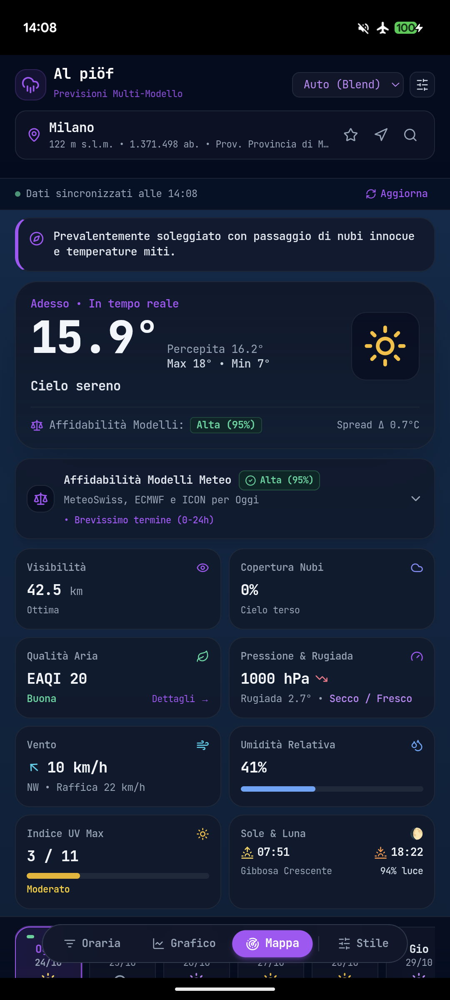
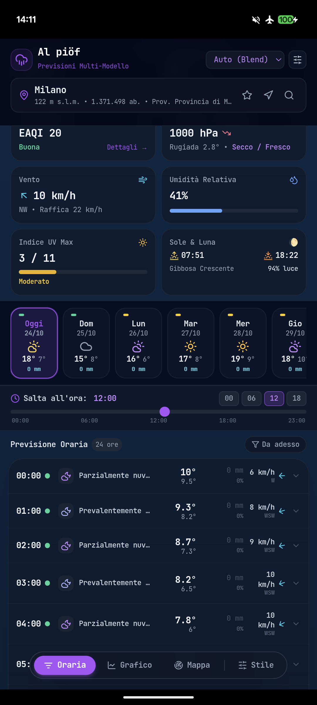
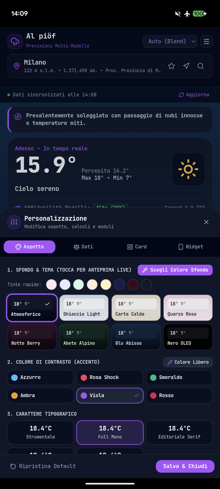
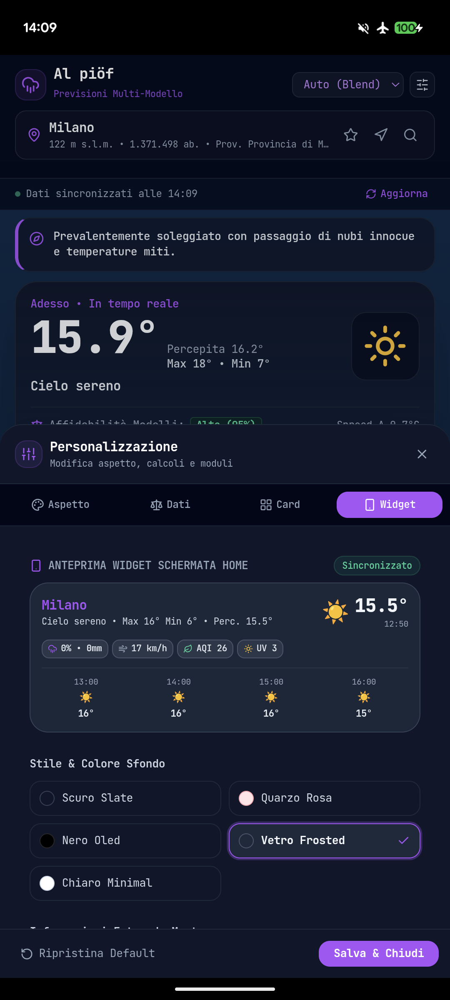

# 🌦️ Al piöf — Previsioni Meteo Multi-Modello & Widget Android

<div align="center">


**Un'applicazione meteo mobile-first e Android nativa ad alta precisione, priva di pubblicità, basata sul consenso tra i modelli MeteoSwiss (ICON-CH2) ed ECMWF, con Widget personalizzabile per la Home Screen.**

<p align="center">
  
  
  
  
</p>

[Caratteristiche](#caratteristiche) • [La Genesi: Vibe Coding](#vibe-coding) • [Widget Android](#widget-android) • [Architettura](#architettura) • [Installazione](#installazione)

</div>

---

<a id="vibe-coding"></a>
## 💡 La Genesi: Esperimento di "Pure Vibe Coding"

Tutto nasce da uno **sbatti quotidiano**: aprire le consuete app meteo commerciali (3B Meteo, IlMeteo, ecc.) e dover aspettare 30 secondi di pubblicità video non skippabili, schivare banner invasivi a tutto schermo e leggere previsioni spesso basate su modelli globali generici a bassa risoluzione che sulle Prealpi e in Pianura Padana faticano a cogliere microclimi e temporali improvvisi.

Questo progetto è nato come una sfida personale di **AI-Augmented Development / Vibe Coding**:
> *È possibile ideare, ingegnerizzare, rifinire e distribuire un'app meteo completa, con tanto di consenso multi-modello scientifico, dati Copernicus CAMS, radar nazionale e Widget nativo Android in circa 48 ore di tempo perso, lanciando prompt ragionati e chirurgici a un agente AI mentre si fa tutt'altro (lavoro quotidiano, commissioni, vita)?*

La risposta è **Al piöf** (*"Piove"*, in dialetto lombardo/bergamasco):
- **Nessun framework bloatware:** codice pulito, TypeScript in modalità `strict: true` (zero `any`).
- **Nessun intermediario a pagamento:** zero abbonamenti, zero API key commerciali da registrare.
- **Funziona subito:** disponibile sia come file `.apk` installabile su qualsiasi smartphone Android, sia come Web App / PWA pronta per Vercel e utilizzabile su iPhone/iOS tramite Safari (*"Aggiungi a Home"*).

---

<a id="caratteristiche"></a>
## ⚡ Caratteristiche Principali

### 1. 🤖 Algoritmo di Consenso Multi-Modello (Regola del 2-su-3)
La maggior parte delle app meteo si affida a un solo modello matematico o prende il peggior codice orario della giornata (basta una goccia da 0.1 mm alle 3 del mattino per marchiare l'intera giornata con l'icona di un temporale).
- **MeteoSwiss ICON-CH2 (1-2 km):** il modello ad altissima risoluzione della Confederazione Elvetica, imbattibile per orografia alpina, prealpina e laghi del Nord Italia.
- **ECMWF IFS025 (9 km):** il prestigioso modello globale del Centro Europeo a medio termine.
- **DWD ICON-D2 / Seamless:** la fisica atmosferica del servizio meteorologico tedesco.
- **Riconciliazione automatica:** se 2 modelli su 3 prevedono cielo coperto ma asciutto, l'app mostra una nuvola e non un'icona di pioggia ingannevole.

### 2. 🌡️ Temperatura in Tempo Reale & Percezione Fisiologica
- **Interpolazione al minuto:** tra un'ora e l'altra la temperatura non resta congelata al valore fisso di inizio ora, ma viene interpolata matematicamente al minuto, rispecchiando l'esatta curva termica di riscaldamento/raffreddamento senza fare chiamate di rete inutili.
- **Calcolo fisiologico europeo del percepito:** risolto il noto difetto di Open-Meteo (che usa la formula australiana e sottrae 4-5°C a caso con un filo di vento). *Al piöf* adotta lo standard europeo: zona di comfort termico, Wind Chill (solo sotto i 10°C) e Humidex (per il caldo afoso estivo), considerando la radiazione solare reale.

<a id="widget-android"></a>
### 3. 📱 Widget Android Nativo Personalizzabile (4x1 • 4x2)
Sviluppato nativamente con `RemoteViews` e `AppWidgetProvider` in Java/Android per garantire **zero drain di batteria** e massima fluidità:
- **Formato Base 4x1 con Prossime 4 Ore sempre visibili:** progettato per occupare 4x1 celle sulla Home Screen mostrando meteo attuale, card informative scelte e la fascia oraria fissa con l'andamento delle **prossime 4 ore**.
- **5 Stili grafici dedicati:** *Scuro Slate*, *Quarzo Rosa (Pastello)*, *Nero OLED Puro* (salva-batteria), *Vetro Frosted* e *Chiaro Minimal*.
- **6 Card informative extra a scelta:** attiva o disattiva liberamente **Pioggia (% e mm)**, **Vento (km/h)**, **Qualità dell'Aria (EAQI)**, **Indice UV**, **Pressione Atmosferica (hPa)** e **Umidità Relativa (%)**.
- **Espansione automatica 5 Giorni (`4x2`):** ridimensionando il widget in verticale sulla Home Screen in formato **4x2**, compaiono automaticamente sotto le 4 ore tutte le previsioni generali dei **prossimi 5 giorni**.
- **Anteprima interattiva 1:1 in-app:** simula in tempo reale temi, card attive e formati (`4x1` / `4x2`) direttamente nelle impostazioni prima di posizionarlo sulla Home.

### 4. 🍃 Qualità dell'Aria & Pollini CAMS Copernicus
Dati in tempo reale dal programma europeo Copernicus:
- Indice Europeo Qualità dell'Aria (**EAQI**), $\text{PM}_{10}$, $\text{PM}_{2.5}$, Ozono ($O_3$) e Biossido di Azoto ($NO_2$).
- **Monitoraggio 6 specie di pollini:** Betulla, Ontano, Graminacee, Artemisia, Olivo e Ambrosia, con valori decimali e **calendario fenologico stagionale** (evita il panico da "zero pollini" spiegando quando la pianta è in riposo vegetativo).

### 5. 📡 Mappa Radar e Precipitazioni Interattiva
- **Radar & Precipitazioni ECMWF:** animazione dinamica dei nuclei di pioggia con timeline oraria interattiva e nowcast predittivo per monitorare temporali e rovesci in tempo reale.

### 6. 🔄 Aggiornamenti In-App Automatici (Android APK)
Nessun bisogno di controllare manualmente GitHub: esclusivamente sull'app Android nativa (disattivato su Web/Vercel che si aggiorna in automatico), un checker all'avvio rileva eventuali nuove release e mostra un **modale in sovraimpressione** con l'elenco puntato delle novità per scaricare con un tocco il nuovo `.apk`.

---

<a id="architettura"></a>
## 🛠️ Architettura Tecnica

```text
├── android/                         # Runtime Android & Capacitor
│   └── app/src/main/
│       ├── java/it/alpiof/app/
│       │   ├── MainActivity.java           # BridgeActivity Capacitor
│       │   ├── WeatherWidgetProvider.java  # Gestione nativa del Widget Android
│       │   └── WidgetBridgePlugin.java     # Plugin di sincronizzazione Web -> Android
│       └── res/
│           ├── layout/widget_weather.xml   # Layout XML del Widget
│           └── drawable/                   # Stili e sfondi (OLED, Rosa, Slate, Glass)
├── src/
│   ├── api/
│   │   ├── weatherApi.ts           # Client Open-Meteo Forecast & Multi-Modello
│   │   ├── airQualityApi.ts        # Client CAMS Copernicus Air Quality
│   │   └── geocodingApi.ts         # Reverse Geocoding & Ricerca coordinate
│   ├── components/
│   │   ├── forecast/               # Scrubber orario, lista verticale 24h, grafici SVG
│   │   ├── hero/                   # Hero in tempo reale, Bento Grid, modale qualità aria
│   │   ├── layout/                 # TopBar, status bar, banner aggiornamenti GitHub
│   │   ├── radar/                  # Mappa radar interattiva Windy
│   │   └── settings/               # Selettore temi, anteprima widget, opzioni calcoli
│   ├── hooks/
│   │   └── useWeatherData.ts       # Hook unificato con cache TanStack & interpolazione
│   ├── store/
│   │   └── useAppStore.ts          # Stato globale persistito su localStorage (Zustand)
│   └── utils/
│       ├── meteoMath.ts            # Formule fisiologiche, dew point, Wind Chill, Humidex
│       ├── weatherConsensus.ts     # Algoritmo di voto e coerenza tra modelli
│       ├── themePalettes.ts        # Generatore di scale cromatiche neutre e accenti
│       ├── updateChecker.ts        # Verifica automatica nuove release da GitHub
│       └── widgetBridge.ts         # Interfaccia TypeScript verso il widget Android
├── vercel.json                     # Configurazione routing SPA per deploy Vercel
└── vite.config.ts                  # Bundler Vite con plugin React
```

---

<a id="installazione"></a>
## 🚀 Installazione & Download APK

### Scaricare l'APK pre-compilato
1. Vai nella sezione [**Releases**](https://github.com/BeLorenzo/al-piof/releases) di questo repository.
2. Scarica il file `al-piof-v1.0.4.apk` (o la versione più recente disponibile).
3. Aprilo sul tuo smartphone Android e conferma l'installazione (autorizzando l'installazione da browser/fonti sconosciute se richiesto).
4. Vai sulla Home, tieni premuto su uno spazio vuoto $\rightarrow$ **Widget** $\rightarrow$ cerca **Al piöf** e trascinalo sullo schermo!

---

### Compilazione da Sorgente (Per Sviluppatori)

Requisiti: **Node.js 18+**, **Java JDK 17+** e **Android SDK** (Android Studio o Command Line Tools).

```bash
# 1. Clona il repository
git clone https://github.com/BeLorenzo/al-piof.git
cd al-piof

# 2. Installa le dipendenze
npm install

# 3. Esegui in locale su browser (Web App)
npm run dev

# 4. Compila il bundle di produzione e sincronizza con Capacitor
npm run build
npx cap sync android

# 5. Compila l'APK Android
cd android
./gradlew assembleDebug

# L'APK compilato si troverà in:
# android/app/build/outputs/apk/debug/app-debug.apk
```

Per installarlo direttamente sullo smartphone collegato via USB con debug attivo:
```bash
adb install -r android/app/build/outputs/apk/debug/app-debug.apk
```

---

## 🌐 Deploy su Vercel (Web / iPhone)

Il progetto è già configurato per Vercel:
1. Collega questo repository su [Vercel](https://vercel.com).
2. Framework Preset: **Vite**.
3. Build Command: `npm run build`.
4. Output Directory: `dist`.
5. Apri il link dal browser Safari del tuo iPhone e tocca il tasto Condividi $\rightarrow$ *"Aggiungi a schermata Home"*.

---

## 📄 Licenza

Distribuito sotto licenza **MIT**. Libero per uso personale, modifica e studio.
Dati meteorologici forniti gratuitamente da [Open-Meteo.com](https://open-meteo.com) sotto licenza Attribution 4.0 International (CC BY 4.0).
Mappe radar fornite da [Windy.com](https://www.windy.com).
